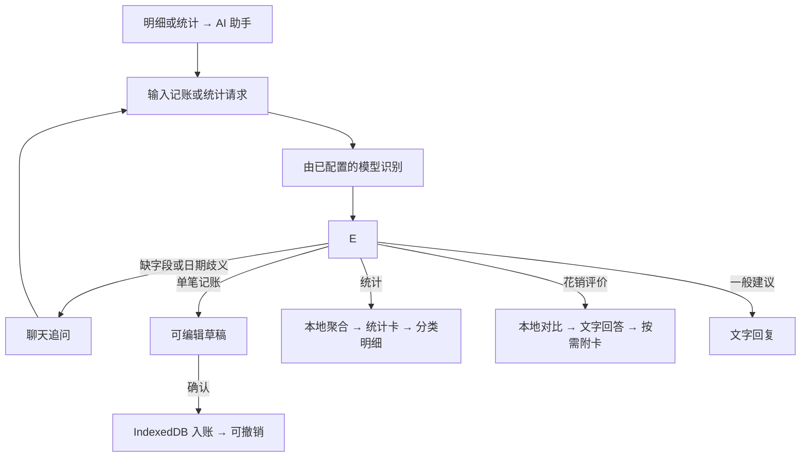

# AI 助手交互与技术方案

## 入口与页面

- 明细和统计的右下悬浮按钮「✦ AI」打开同一会话。底栏中间是「记一笔」。聊天页返回原入口，设置页返回来处。
- 聊天首屏提供「试一句记账」「试查本月收支」。消息分左右，输入框靠下。待入账卡包含金额、日期、分类、备注和确认、取消操作；保存后显示「已入账」和撤销入口。
- 统计卡显示真实日期范围、收支额、分类金额与占比，点击一行展开明细。原页面的隐藏金额设置也用于 AI 汇总和入账回执；草稿编辑保留实际输入值供核对。
- 入账回执和统计卡与消息一起按时间渲染。统计卡记录当时的查询结果，每张卡自己的展开状态相互独立。「新会话」保留旧会话并开启空白会话，正在等待的请求取消；在顶部点「历史」可恢复旧聊天、卡片、草稿及上下文。
- 模型自主组合标题、正文、要点和本机数据块。问「购物怎么花了这么多」时，查询先限定购物分类，再解释并附相关流水；单纯聊天或问建议可自由回文字。金额隐藏或分析请求失败时用本机结果兜底。
- 模型配置作为既有设置页的子页，避免改变主要导航。Key 使用密码输入，已保存的值不会回显。更换地址时如果没重新输入 Key，旧 Key 不会发送给新服务。

## Web 实现

- `assistant-model.js` 校验模型返回。金额以元字符串进入校验，转换为整数分。日期复用现有模型校验，区间含首尾，结束日超过今天时截到今天。
- `assistant.js` 管理页面会话、待补全信息、草稿、统计和配置。复用 `storage.js` 的流水读写以及 `model.js` 的日期过滤、收支与分类聚合。云端无数据库访问，也无自由调用工具的权限。
- `storage.js` 将 IndexedDB 升至第 2 版，新增独立会话表，保留原有账本。会话历史和最近打开的会话在同一浏览器地址下持久化；账本 JSON 的格式保持原样。
- `assistant-bridge.js` 是无 npm 依赖的本机调试服务。同源调用 `POST /ai/api`，向配置的服务发 `POST <API 地址>/chat/completions`。地址填基础路径（如 `https://服务域名/v1`）。使用兼容 Chat Completions 的 `choices[0].message.content` JSON 文本，模型须支持相应回包；参考 [Chat Completions 接口](https://platform.openai.com/docs/api-reference/chat/create)。
- 本机服务拒绝跨来源调用、带账户信息的 URL 和上游重定向。API 地址使用 HTTPS，连接本机模型时可用 HTTP。配置模型后可测试连接并聊天；Key 作为上游鉴权头使用。
- 界面保留本会话消息，识别请求只接收当前输入、上一条用户输入片段、日期、最近统计条件和必要的追问，不回传整段历史。系统提示词见 [完整文本](AI助手-系统提示词.md)。
- 查询、对比和评价时，浏览器生成限定范围、可选分类的本机快照。通过 `task:"analyze"` 把汇总交给模型，模型按需选择 `entries`、`totals`、`categories` 或 `comparison`，由浏览器用原值填充。匿名排行中的分类名用占位符在本机渲染。原始流水、备注和分类名列表不进入分析请求。金额隐藏时不发送汇总。
- 所有模型文字按纯文本转义，数据块只接受白名单，不执行模型返回的 HTML。历史中的旧统计卡仍可查看，新回复保存为富文本块与查询快照。

## 调试步骤

1. 在 `project/web/` 运行 `npm start`，打开 `http://127.0.0.1:4173/`。如需与原 Web 服务并行，设置 `LEDGER_WEB_PORT`；不同端口对应独立浏览器账本。
2. 打开 AI 助手设置，填 API 基础地址和模型 ID，按服务要求填 Key，保存或测试连接。
3. 测试「今天中午吃叉烧饭花了28元」「帮我统计下这个月花销」「上个月呢」。确认入账回执、两个统计卡片沿聊天消息保留，再点「新会话」确认清理上下文。
4. 安装到 Android 前评估移动端的 Key 保存与网络配置，保持相同的意图校验、入账确认和本地统计口径。
